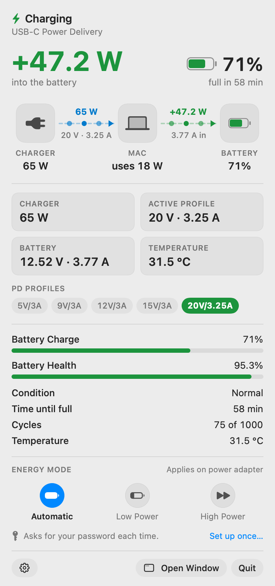
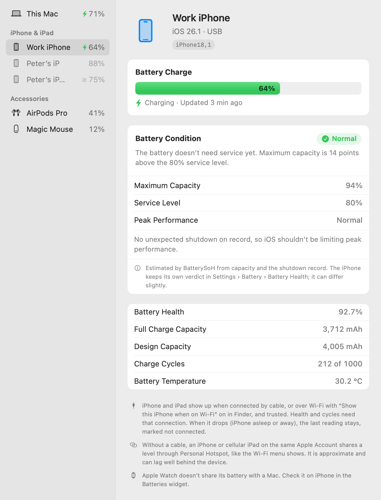
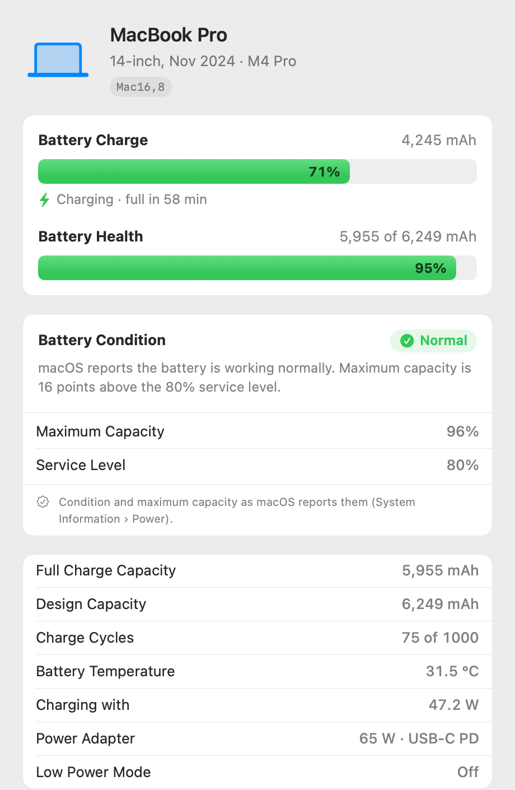
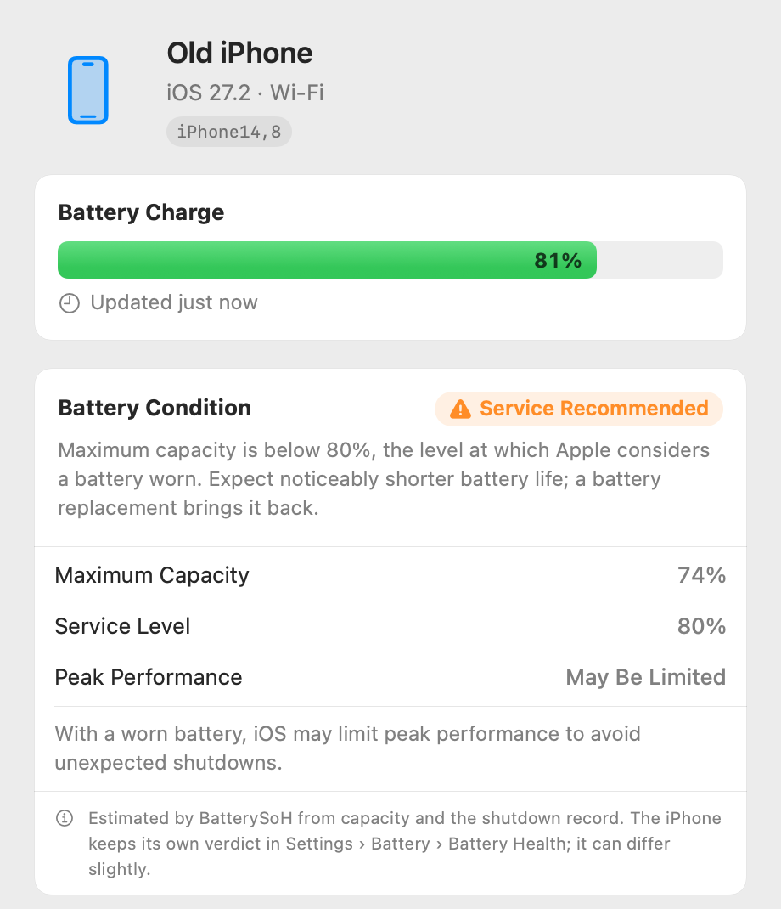

# BatterySoH

**Know your batteries at a glance.** BatterySoH lives in your Mac's menu bar and shows what
your battery and charger are doing right now, how healthy the battery is, and when it needs
service. It shows your iPhone, iPad, AirPods and other accessories too.

Free, small, and private: no account, no ads, no internet connection.

<p align="center">
  
</p>

## What it shows you

- **Right now, in the menu bar.** Charge percent and time left, or a bolt while charging.
  Click it to see where the power goes: how many watts come from the charger, how much your Mac
  uses, and how much goes into the battery.
- **Is my battery healthy?** Battery health, charge cycles, temperature, and a clear
  **Normal** or **Service Recommended**, the same verdict macOS gives in System Information.
- **Does my iPhone need a new battery?** For an iPhone or iPad connected to your Mac, BatterySoH
  shows its charge, health, cycles, and whether it likely needs service. For iPhone it also
  shows whether iOS may be limiting **peak performance**.
- **Everything else with a battery.** AirPods (left, right and case), Magic Mouse, Keyboard,
  Trackpad and other Bluetooth accessories, all in one window.
- **How it ages.** BatterySoH writes down your Mac's battery health once a day and draws it as
  a chart, so you can see the trend over months.
- **The same controls as macOS.** Switch Energy Mode (Automatic, Low Power, High Power) and
  use "Charge to Full Now" when macOS is holding the charge at its limit.

<p align="center">
  
</p>

<p align="center">
  
  &nbsp;
  
</p>

## Install

1. Download the latest **BatterySoH .dmg** from the
   [Releases](https://github.com/peterquocnguyen/BatterySoH/releases) page.
2. Open it and drag **BatterySoH** onto **Applications**.
3. Open BatterySoH from Applications. Its icon appears in the menu bar; there is no Dock icon.

The first time, macOS may say it can't check the app for malicious software, because
BatterySoH isn't notarized by Apple yet. Open **System Settings › Privacy & Security**,
scroll down, and click **Open Anyway** next to BatterySoH. You only need to do this once.

**Requirements:** a Mac laptop with macOS 14 Sonoma or later. Apple silicon Macs are fully
supported; Intel Macs should work but are tested less.

## Your iPhone and iPad

- **Connect it by cable** once, unlock it and tap **Trust**. BatterySoH then shows its charge,
  battery health and cycles.
- **To see it without a cable:** with the iPhone connected, open Finder, select the iPhone and
  turn on **Show this iPhone when on Wi-Fi**. From then on BatterySoH reads it whenever both
  are on the same Wi-Fi.
- **No cable at all?** An iPhone on the same Apple Account still shows a rough level, the one
  it shares for Personal Hotspot. It can be out of date, so BatterySoH marks it with ≈.
- When the iPhone disconnects, its last reading stays, marked "not connected".

iOS doesn't share its own Battery Health screen with a Mac, so for iPhone and iPad the
condition and peak performance are BatterySoH's estimate from the battery's capacity and
shutdown record. It can differ slightly from **Settings › Battery › Battery Health** on the
device.

Apple Watch can't be shown: it shares its battery only with its paired iPhone.

## Privacy

- BatterySoH makes **no network connections** and collects nothing.
- It only **reads** battery information. Settings it changes are macOS's own (Energy Mode,
  "Charge to Full Now"), and macOS asks for your password where it normally would.
- It keeps your battery history and the last reading of each iPhone / iPad on your Mac, in
  `~/Library/Application Support/BatterySoH/`.

## Questions

**What's the difference between "Battery Health" and "Maximum Capacity"?**
Both compare the battery today with when it was new. Maximum Capacity is the number macOS and
iOS show in Settings; Battery Health is the battery's own live measurement, so the two can
differ by a few percent. Apple recommends service once Maximum Capacity drops below 80 %.

**How do I report a problem?**
Open BatterySoH's Settings, go to **About** and click **Copy Diagnostics**, then paste the text
into your report. It contains no serial numbers.

## For developers

BatterySoH is a Swift package (SwiftUI, no third-party dependencies). Building the app needs
Xcode.

```sh
swift build                      # build everything
swift test                       # run the tests
swift run sohstat                # battery details in the terminal (--devices, --json)
scripts/bundle.sh --dmg          # build/BatterySoH.app and build/BatterySoH-<version>.dmg
```

The product spec is in [docs/SPEC.md](docs/SPEC.md).

---

By Peter Quoc · © 2026 Peter Quoc · Version 0.2.0
